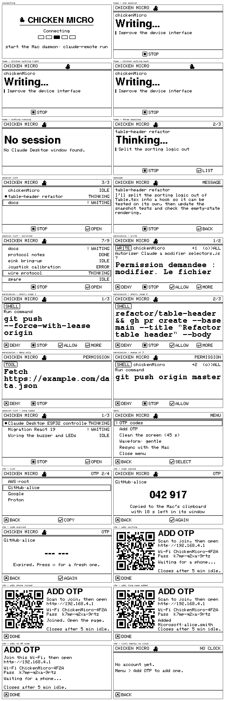

# ChickenMicro

[](https://github.com/salnika/chickenMicro/actions/workflows/ci.yml)
[](LICENSE)


A physical desk terminal for Claude Desktop on macOS.

An e-ink box shows what Claude is doing — its state, its last message, or a
pending permission request — and four keys let you **approve** or **deny** an
action without touching the keyboard. Several Claude Desktop windows, and
several copies of the app, all show up as sessions you can page through.

```
┌──────────────────────────────────────┐
│ CHICKEN MICRO                    1/3 │
│ [SHELL] docs              +1 waiting │
│ Autoriser Claude a modifier ?        │
│ git push origin master               │
├──────────────────────────────────────┤
│ [x]DENY  [#]STOP  [v]ALLOW  [<]MORE  │
└──────────────────────────────────────┘
    x        #        v        <         (o) joystick
```

Two programs:

- **`mac/`** — a Node daemon that reads Claude Desktop through the macOS
  Accessibility API and presses its buttons with `AXUIElementPerformAction`,
  called directly through FFI.
- **`esp32/`** — C++/Arduino firmware for an ESP32 DevKit V1 driving the e-ink
  panel and the controls.

They talk NDJSON over USB serial. The protocol is in
[`protocol/PROTOCOL.md`](protocol/PROTOCOL.md).

---

## Layout

```
chickenMicro/
├── README.md
├── CONTRIBUTING.md
├── SECURITY.md                  threat model and how to report privately
├── protocol/
│   └── PROTOCOL.md              wire protocol, v1
├── mac/                         Node daemon
│   ├── package.json
│   ├── bin/claude-remote.js     the CLI
│   ├── src/
│   │   ├── protocol/            constants, enums, framing, NDJSON codec
│   │   ├── session/             permission gate, request ids, sessions, coordinator
│   │   ├── transport/           serial + port discovery
│   │   ├── accessibility/       koffi bindings, interpreter, watcher
│   │   ├── system/              clipboard, log file, process info
│   │   └── simulation/          fixtures and scenes
│   └── test/                    node:test suites
├── esp32/                       PlatformIO project — the firmware
│   ├── platformio.ini
│   ├── include/                 Config.h, DisplayModel.h, headers
│   ├── src/                     App, Display, Controls, SerialProtocol, State
│   ├── tools/preview/           renders every screen to a PNG, no hardware
│   └── test/test_logic/         host unit tests
└── docs/
    ├── wiring.md
    ├── wiring-esp32c3-supermini.md
    ├── setup-macos.md
    ├── troubleshooting.md
    ├── eink-gdey0213z98.md
    ├── otp.md
    ├── images/                  rendered screens, used by this README
    └── reference/               bring-up sketch, and where to get the datasheet
```

---

## Hardware

| Part | Detail |
| ---- | ------ |
| MCU | ESP32 DevKit V1 (ESP32-WROOM-32), USB powered and programmed |
| Display | 2.13" e-ink SPI, 250x122 — GoodDisplay GDEY0213Z98 |
| Buttons | 4 push buttons, keycaps left to right: ✕ ■ ✓ ↵ |
| Joystick | 2 analog axes + click |
| Keycap lights | 4× WS2812B, one under each key (optional) |

Parts list, full pinout and an ASCII diagram:
[`docs/wiring.md`](docs/wiring.md) — nothing needs a PCB, and a breadboard is
enough to get to a working box.

**Smaller build:** an **ESP32-C3 SuperMini** instead of the DevKit, with the five
buttons on an **MCP23008** I²C expander (the SuperMini has too few pins for one
each). Same panel, same joystick, same behaviour — a press during an e-ink
refresh is still never lost. Wiring and bring-up:
[`docs/wiring-esp32c3-supermini.md`](docs/wiring-esp32c3-supermini.md); build it
with `pio run -e esp32-c3-supermini`.

```
EINK VCC  -> ESP32 3V3          JOYSTICK VCC    -> ESP32 3V3
EINK GND  -> ESP32 GND          JOYSTICK GND    -> ESP32 GND
EINK DIN  -> GPIO23             JOYSTICK X      -> GPIO32
EINK CLK  -> GPIO18             JOYSTICK Y      -> GPIO33
EINK CS   -> GPIO5              JOYSTICK SWITCH -> GPIO25
EINK DC   -> GPIO17             other SWITCH leg -> GND
EINK RST  -> GPIO16
EINK BUSY -> GPIO4              ✕ DENY:    GPIO13 -> button -> GND
                                ■ STOP:    GPIO14 -> button -> GND
                                ✓ APPROVE: GPIO27 -> button -> GND
                                ↵ ACTION:  GPIO26 -> button -> GND
```

**3.3 V only** for both the panel and the joystick, and all grounds common.

### Controls

The four keys are in keycap order, and the legend along the bottom of every
screen draws them in that same order — so what the screen offers is always what
the finger above it does. A key that does nothing on the current screen is left
blank rather than moved.

| Key | GPIO | Action |
| --- | ---- | ------ |
| ✕ cross | 13 | **DENY** the request on screen |
| ■ square | 14 | **STOP** the running turn, in the session the screen is pointing at |
| ✓ check | 27 | **APPROVE** the request on screen |
| ↵ return | 26 | open / back / next page; hold for a full redraw |

| Joystick | Action |
| -------- | ------ |
| up / down | move in the session list, page through a message, or step through sessions on the Home screen |
| left / right | Home ⇄ Sessions ⇄ Message |
| **right (permission screen, 2+ queued)** | **approve the whole queue** — shown as `(o)>ALL` |
| click | same as the return key (fires on release) |
| **hold (~0.6 s)** | **open the menu** (hold again to close) |
| — | orientation lives in `Config.h`: the channels are swapped (`kJoystickSwapAxes`), then both axes inverted (`kJoystickInvertX/Y`) |

**Keycap lights.** With a WS2812B under each key, a key lights up exactly when
pressing it does something on the screen — red to deny, green to approve, amber
to stop, faint white to navigate — and flashes white when a press registers. All
dark at rest. The lights and the key legend on the panel come from the same code,
so they cannot disagree. Wiring: [`docs/wiring.md`](docs/wiring.md#keycap-lights-ws2812b).

APPROVE and DENY are dedicated keys and act on a single deliberate press —
never a hold, a repeat, or a double click. Neither is ever reused for
navigation, so muscle memory built on a list cannot become a verdict.

**Approve all** clears a backlog in one gesture when several requests are
waiting: a flick right on the permission screen. It is deliberately the
joystick, not the ✓ key, so a slip on ✓ still approves only the one request on
screen — and it approves the queued requests sight-unseen, so reach for it only
when you know what is waiting.

Claude windows on **another Space, or behind a full-screen app**, are still
tracked: the box keeps showing their permissions and your verdicts still reach
them, without pulling you out of whatever is in front — and a request answered
in the app clears from the box just as fast, wherever its window sits.

> **Wired your caps in another order?** Change the four pins in
> `esp32/include/Config.h`. Check before trusting the box: press each key on the
> Home screen and watch the daemon log for `[INPUT] deny`, `stop`, `approve`,
> `context`.

### Screens

```
┌──────────────────────────────────────┐
│ CHICKEN MICRO                    2/3 │  title bar, 2nd of 3 sessions
├──────────────────────────────────────┤
│ docs                                 │  which session this is
│ Thinking...                          │
│ |Split the sorting logic out         │  the last thing asked of it
├──────────────────────────────────────┤
│ [#] STOP                    [<] LIST │  only the keys that do something here
└──────────────────────────────────────┘
```

| Screen | Shows |
| ------ | ----- |
| **Connecting** | the wordmark and a stepping loader, until the Mac daemon is talking to it |
| **Home** | the session being followed: its state, and the last thing asked of it |
| **Sessions** | every Claude Desktop window, its state, and which one is being followed |
| **Message** | Claude's last reply, paginated |
| **Menu** | device commands, opened by a long joystick press (below) |
| **Permission** | the priority screen: what is being authorised, in which session, and how many others are queued behind it |

Connecting and Permission own the display — they cannot be navigated away from.

### Menu

**Hold the joystick click (~0.6 s)** to open a menu, from Home, Sessions or
Message; hold again — or the ✕ key — to close it. Move with the joystick, and
confirm with a click, ✓, or ↵. It is where device-side commands live:

| Entry | Does |
| ----- | ---- |
| **OTP codes** | pick an account: its one-time code goes to the Mac's clipboard — see [One-time codes](#one-time-codes) |
| **Add OTP** | opens a temporary Wi-Fi page for adding an account; a QR code on the panel joins it |
| **Clean the screen** | the full black → red → white pigment cycle (~45 s) |
| **Waveform: …** | steps through the mono refresh waveforms (`gentle`, `stock`, `deep`) to compare black depth, ghosting and red creep by eye; `deep`, the default, has the strongest black and `stock` refreshes twice as fast; `kDefaultWaveform` in `Config.h` sets the one loaded at boot |
| **Resync with the Mac** | asks the daemon to resend the whole state |
| **Close menu** | back to where you were |

**Clean the screen** is the real thing, not a white flash: it borrows the
panel's tri-colour waveform and drives the pigment to both limits before
settling on white, which is the only way to scrub ghosting *and* red that the
everyday mono waveform cannot move. The panel flashes black, then red, then
white, for about 45 seconds — that is it working, not a fault. It is the same
cycle as the standalone `esp32dev_clear_panel` tool, so that no longer needs
flashing just to clean the glass.

Adding an entry is three edits: a value in `MenuItem` (`esp32/include/State.h`),
its label (`Display.cpp`), and its action (`App::activateMenuItem`).

### One-time codes

The box doubles as a hardware authenticator (TOTP). **Menu → OTP codes**, pick
an account, and its current code lands on the Mac's clipboard — ⌘V to paste — and
on the panel. **Menu → Add OTP** opens a temporary Wi-Fi network with a page to
paste an `otpauth://` link, type a secret key, or paste an
`otpauth-migration://` link to move a whole list from Google Authenticator; the
panel shows a QR code that joins it, and its password, which appears nowhere
else.

The secrets never leave the box, and a code is only made on a press of its keys:
software on the Mac can neither read a secret nor ask for a code. What it does
*not* stop is someone with the board in hand reading the flash, where secrets are
stored unencrypted — [`docs/otp.md`](docs/otp.md) spells out the whole model,
the limits, and what to do when something goes wrong.

The onboard LED (GPIO2) is a status light, dark when there is nothing to do:

| LED | Meaning |
| --- | ------- |
| **off** | idle — connected, nothing waiting |
| **breathing** | not connected to the Mac daemon yet |
| **blinking** | a permission is waiting for a verdict |

So the box catches your eye from across the room even with a full-screen app
covering the panel. Set `kLedPin` to -1 in `esp32/include/Config.h` to leave the
LED alone.

To see any of them without a panel, or without flashing:

```bash
esp32/tools/preview/render.sh
```

It compiles the real layout code against a stub driver and writes a contact
sheet of every screen. This is its output, unretouched — the panel is 250×122,
so each tile is life-size:



---

## Flash it from the browser

[**salnika.github.io/chickenMicro**](https://salnika.github.io/chickenMicro/)
writes the firmware over USB with no toolchain and no checkout, and annotates a
photo of the board with what every part does. It needs a Chromium browser —
Web Serial is how the page reaches the board.

The images it flashes are not committed: the Pages workflow builds every board
variant out of `esp32/` and merges each into one image before the site is
deployed, so what the page writes is always what this repository builds. The
same script runs locally:

```bash
site/scripts/build-firmware.sh
```

```bash
npm install --prefix site
```

```bash
npm run dev --prefix site
```

The site lives in [`site/`](site/) — Vite and TypeScript, one fixed screen, no
framework. [`site/photo/README.md`](site/photo/README.md) explains how the
board photo is cropped and what to redo if it is replaced.

---

## Install

From an empty desk to a working box, in five stages. Each one links to the page
that covers it in full, so this table is the map and nothing below it repeats.

| | Stage | Where |
| - | ----- | ----- |
| 1 | **Buy the parts** — one board, one panel, four buttons, a joystick | [`docs/wiring.md`](docs/wiring.md#bill-of-materials) |
| 2 | **Wire it up** — 15 connections, no PCB, breadboard is fine | [`docs/wiring.md`](docs/wiring.md) |
| 3 | **Install the toolchain** — Node and PlatformIO | [Prerequisites](#prerequisites), below |
| 4 | **Flash, grant Accessibility, run** — 18 steps, once | [First run](#first-run), below |
| 5 | **Start it at login** — optional | [`docs/setup-macos.md`](docs/setup-macos.md#running-it-as-a-login-agent-optional) |

**No hardware yet?** Stages 1 and 2 can wait: the daemon, the protocol and every
screen can be driven with no board at all — see
[Testing without Claude Desktop](#testing-without-claude-desktop).

Anything that goes wrong at any stage:
[`docs/troubleshooting.md`](docs/troubleshooting.md).

### Prerequisites

```bash
brew install node platformio
```

Node 20 or newer. Details and alternatives:
[`docs/setup-macos.md`](docs/setup-macos.md).

### Mac daemon

```bash
cd mac
npm install
```

Then:

```bash
node bin/claude-remote.js ports
```

```bash
node bin/claude-remote.js dump
```

```bash
node bin/claude-remote.js run
```

`npm link` puts `claude-remote` on your PATH if you prefer the short form.

### Firmware

```bash
cd esp32
pio run
```

```bash
pio run --target upload
```

```bash
pio device monitor
```

Environments: `esp32dev` (default), `esp32dev_mock` (no panel),
`esp32-s3-devkitc-1`, `esp32-c3-supermini` (buttons on an MCP23008),
`esp32dev_clear_panel` (one-shot red cleaner), `native` (host tests). Pick one
with `-e`, e.g. `pio run -e esp32-c3-supermini --target upload`.

### Tests

```bash
cd mac && npm test
```

```bash
cd esp32 && pio test -e native
```

---

## First run

Follow this once, in order.

**1. Plug the ESP32 in** over USB — a data cable, not charge-only.

**2. Find the port.**

```bash
ls /dev/cu.*
```

Expect `/dev/cu.usbserial-XXXX` or `/dev/cu.wchusbserial-XXXX`. Nothing there
means a missing USB-UART driver — see
[`docs/troubleshooting.md`](docs/troubleshooting.md).

**3. Build and flash the firmware.**

```bash
cd esp32
pio run --target upload
```

**4. Check the serial log.**

```bash
pio device monitor
```

You should see, as NDJSON:

```json
{"v":1,"type":"log","level":"info","message":"[boot] chickenmicro-fw 1.0.0, panel GDEY0213Z98 (mono, fast partial)"}
{"v":1,"type":"log","level":"info","message":"[display] GDEY0213Z98 (mono, fast partial), 250x122"}
{"v":1,"type":"log","level":"info","message":"[input] joystick centre x=1893 y=2044, dead zone 700"}
{"v":1,"type":"hello","role":"device","app":"chickenmicro-fw","version":"1.0.0"}
```

The panel shows `CLAUDE / Disconnected`. **Quit the monitor now** — it holds
the port, and the daemon cannot open it at the same time.

**5. Install the Mac daemon's dependencies.**

```bash
cd ../mac
npm install
```

**6. Run the inspector.**

```bash
node bin/claude-remote.js dump
```

The first run will fail with an explanation and trigger the macOS prompt: the
Accessibility permission is missing.

**7. Grant Accessibility.** Open **System Settings → Privacy & Security →
Accessibility** (*Réglages système → Confidentialité et sécurité →
Accessibilité*), click **+**, press <kbd>⌘</kbd><kbd>⇧</kbd><kbd>G</kbd>, and
paste **the exact path the command printed**. Because this is a Node program,
macOS attaches the grant to the app that launched it — run `doctor` and use
the path it prints under `launched by`:

```
/path/to/node        (doctor prints the exact path)
```

Enable the switch. `claude-remote doctor` always prints the path to authorise,
so use that rather than typing one from memory.

> **This grant is broader than it looks.** macOS attaches it to the app that
> launched the daemon — normally your terminal — so everything that terminal
> runs inherits Accessibility access. `doctor` prints the exact target under
> `launched by`. See [`docs/setup-macos.md`](docs/setup-macos.md).

**8. Check it took.**

```bash
node bin/claude-remote.js doctor
```

**9. Open Claude Desktop.**

**10. Verify the Accessibility tree.**

```bash
node bin/claude-remote.js dump --filter button
```

You should see Claude's buttons. A plain `dump` ends with an
`--- interpreted ---` block showing what the daemon made of the tree — that is
the fastest way to tell whether the selectors still match.

**11. Start the daemon.**

```bash
node bin/claude-remote.js run
```

**12. The device should show `Connected`** — the status screen's header reads
`link`, and the daemon logs:

```
[SERIAL] connected /dev/cu.usbserial-0001 @ 115200 8N1
[SESSION] device connected, resynchronising
[AX] Claude Desktop detected (pid 1234), 7 AX notifications registered
```

**13. Send Claude a message.**

**14. Watch the device** follow `thinking` → `writing` → `done`, and show the
reply. Push the joystick right to switch to the message screen, up/down to
scroll.

**15. Trigger a harmless permission request.** Ask Claude to run something
inert, for example:

> Run `echo hello` in the terminal

The device switches to the permission screen and shows the command.

**16. Press DENY** — the ✕ key, GPIO13. The daemon logs:

```
[SERIAL] Received deny req-1
[AX] Pressing button "…AXButton[Deny]"
```

Claude's dialog closes as refused.

**17. Ask again.**

**18. Press APPROVE** — the ✓ key, GPIO27. The command runs.

If a press is refused, the log says which guard caught it — see
[Safety](#safety) and the troubleshooting table.

---

## Testing without Claude Desktop

`simulate` drives the device from synthetic Accessibility trees, through the
real interpreter, gate and coordinator — so the firmware receives exactly what
a live session produces, request ids and approve gating included.

```bash
cd mac
node bin/claude-remote.js simulate
```

Cycles every screen. Or pick one:

```bash
node bin/claude-remote.js simulate permission
```

Scenes: `idle`, `thinking`, `writing`, `message`, `permission`,
`long-permission`, `sessions`, `queue`, `error`, `demo`.

`sessions` opens three windows at once; `queue` has two of them asking for
permission at the same time, which is how to see the device answer them one at a
time with `+1 waiting` in the corner.

To see the wire format instead of using a device:

```bash
node bin/claude-remote.js simulate permission --stdout
```

```json
{"v":1,"type":"hello","role":"mac","app":"claude-remote","version":"1.1.0","approveDelayMs":200}
{"v":1,"type":"sessions","focus":"s1","permission":"s1.req-1","total":1,"sessions":[{"id":"s1","name":"Session 1","state":"waiting_permission"}]}
{"v":1,"type":"state","state":"waiting_permission","detail":"Push my branch"}
{"v":1,"type":"permission","id":"s1.req-1","kind":"shell","session":"s1","title":"Run command","content":"git push origin master","actions":["deny","approve"]}
```

Pressing APPROVE or DENY during a simulated permission goes through the normal
validation path and is logged — nothing reaches Claude, because there is no
Claude in the loop.

**No display yet?** Flash the mock build. It renders into RAM and reports what
it drew as `log` frames, so controls and protocol can be finished before the
panel arrives:

```bash
cd esp32
pio run -e esp32dev_mock --target upload
```

**Want to see the screens without flashing anything?** The preview harness
compiles the real layout code against a stub driver and writes a contact sheet
of every screen:

```bash
esp32/tools/preview/render.sh
```

It is worth running after any change to `Display.cpp`: text that overruns its
band or a legend that collides with the line above it are invisible in a
compiler's output and obvious in the image.

---

## Commands

```
claude-remote ports                        list candidate USB-serial ports
claude-remote sessions                     list the Claude windows the daemon sees
claude-remote dump [--filter <text>]       print Claude's Accessibility tree
claude-remote run [--serial <path>]        run the daemon
claude-remote simulate [scene]             fake events, no Claude needed
claude-remote doctor                       check permissions, port, Claude
```

`sessions` is the one to reach for when the box shows nothing: it prints, per
window, the state the daemon read, the request it found and the buttons it
bound — before any hardware is involved.

| Option | Meaning |
| ------ | ------- |
| `--serial <path>` | serial port; auto-detected when omitted |
| `--baud <rate>` | default 115200 |
| `--filter <text>` | `dump`: only matching elements |
| `--depth <n>` | max tree depth (default 60, shared by every command) |
| `--approve-delay <ms>` | arming delay before APPROVE counts (default 200) |
| `--log <level>` | `debug` \| `info` \| `warn` \| `error` |
| `--log-file <path>` | `run`: where to keep the log (default `~/Library/Logs/claude-remote/claude-remote.log`) |
| `--log-file-level <level>` | `run`: level for the file (default: same as `--log`) |
| `--no-log-file` | `run`: keep no log file |
| `--stdout` | `simulate`: print frames instead of using serial |
| `--no-prompt` | do not trigger the macOS Accessibility prompt |

---

## Safety

APPROVE authorises a real action, so it is guarded on both sides
independently ([PROTOCOL.md §5](protocol/PROTOCOL.md)):

- **Nothing is ever auto-approved.** Only a single deliberate press of the
  dedicated button emits `approve`.
- **Every verdict is bound to a request id.** The device refuses to send one
  that is not the permission on screen; the daemon refuses one that is not the
  request currently pending.
- **The tree is re-read immediately before pressing.** If Claude swapped the
  dialog between display and press, the id no longer matches and the press is
  abandoned — approving an old request cannot authorise a new command.
- **An arming delay** (200 ms, `--approve-delay`) absorbs a press that was
  already in flight when the screen changed.
- **The screen moves on with the press, and the request can come back.** The
  box leaves the permission the moment it sends a verdict, so a press feels
  immediate instead of waiting on the Mac. The request is held aside rather than
  dropped: it is unanswerable while it waits, and it comes back on screen, armed
  afresh, if the Mac has not confirmed within three seconds — or sooner, since
  the Mac re-sends it the moment a verdict cannot be applied.
- **A pending permission is dropped** the moment it disappears from Claude, the
  state leaves `waiting_permission`, or the link goes quiet for 10 s.
- **Serial noise cannot become an action.** Frames must be valid JSON with the
  right version, a known type and an enum-valid action; an oversized line is
  discarded whole rather than reparsed.

---

## The e-ink model

One line, in [`esp32/include/DisplayModel.h`](esp32/include/DisplayModel.h):

```cpp
#define EINK_MODEL   EINK_MODEL_GDEY0213Z98_FAST
```

| Value | Panel |
| ----- | ----- |
| `EINK_MODEL_GDEY0213Z98_FAST` | default — GDEY0213Z98 as **monochrome**, ~300 ms partial refresh |
| `EINK_MODEL_GDEY0213Z98_TRI` | same panel in 3 colours; ~14 s full refresh, no partial |
| `EINK_MODEL_MOCK` | no panel; renders to RAM and logs what it drew |

The default is monochrome and the build proves it — the linker keeps
`GxEPD2_213_BN.cpp.o` and drops `GxEPD2_213_Z98c.cpp.o`, so no red-plane code
ships at all.

### Clearing red left on the glass

The mono waveform only drives black↔white; it **cannot move red pigment**. Red
put there by a previous tri-colour session therefore stays on the panel, showing
through under the UI. Wipe it once with the standalone cleaner:

```bash
cd esp32
pio run -e esp32dev_clear_panel --target upload
```

```bash
pio device monitor
```

It cycles the pigment black → red → white with the tri-colour waveform (~45 s),
then tells you to put the firmware back:

```bash
pio run -e esp32dev --target upload
```

Only needed once after a tri-colour experiment, or whenever red patches appear.
A panel that has only ever run in mono does not need it.

If your geometry differs, `EINK_WIDTH` / `EINK_HEIGHT` / `EINK_ROTATION` are at
the bottom of the same file. Nothing else in the firmware names a panel class —
everything draws through `DisplayDriver`, so this really is the only edit.

Adding a different panel: find its class in GxEPD2's `src/gdey/` (mono) or
`src/gdey3c/` (3-colour), add a model block following the existing one, and
point `EINK_MODEL` at it. The file spells out the procedure inline.

Measured behaviour of this panel, including why the monochrome path is the
default: [`docs/eink-gdey0213z98.md`](docs/eink-gdey0213z98.md).

---

## Known limitations with Claude Desktop

Claude Desktop is an Electron app. Its Accessibility tree has **no stable
identifiers** and can change between releases, so recognition is heuristic:

- **Permission detection** needs one container holding both an approve-ish and
  a deny-ish *pressable* element. New button wording breaks it until
  `approveLabels` / `denyLabels` in
  [`selectors.js`](mac/src/accessibility/selectors.js) are updated.
  `claude-remote dump --filter button` shows the real labels.
- **There is no request id in the tree.** The daemon synthesises one from the
  dialog's visible content, stable while the dialog stays up and fresh as soon
  as the content changes.
- **`idle` vs `done`** cannot be distinguished from a single snapshot; `done` is
  reported once after a turn ends, then it settles to `idle`.
- **Transcript extraction is heuristic.** The densest scroll area is taken as
  the conversation and split by speaker markers. When markers are absent, the
  trailing text is assumed to be the reply.
- **Electron builds the tree lazily.** A window that has never been interacted
  with may expose almost nothing until it is clicked.
- **Background operation depends on the control.** `AXUIElementPerformAction`
  normally works without focus, which is why it is used instead of synthetic
  keystrokes — but a control that only handles raw key events will not respond.
- **A control with no `AXPress`** cannot be actuated at all. The daemon reports
  `no approve button bound` rather than falling back to clicking coordinates.

Two more come from running on Node rather than natively:

- **No `AXObserver`.** Its callbacks arrive on a `CFRunLoop`, and Node's loop is
  libuv, so the daemon polls instead. The watcher times each read and backs off
  to at least three times the last duration, so a slow tree throttles itself
  rather than pinning a core — but it is polling, not push.
- **The Accessibility grant attaches to the application that launched the
  daemon** — normally your terminal — not to a purpose-built executable. So it
  is shared with everything else that terminal runs. A LaunchAgent has no parent
  app and scopes the grant to the binary alone.

`claude-remote dump` exists precisely so these can be diagnosed and the
selectors adjusted without touching anything else.

---

## Logs

Mac, to stderr (stdout stays clean for `ports` and `dump`):

```
[AX] Claude Desktop detected (pid 1234), 7 AX notifications registered
[AX] Permission detected: req-1 (shell)
[SERIAL] -> {"v":1,"type":"permission",...}
[SERIAL] Received approve req-1
[AX] Pressing button "…AXButton[Allow]"
```

Device, as protocol `log` frames — readable in `pio device monitor` and
re-printed by the daemon as `[DEVICE] …`:

```
[serial] connected
[state] waiting_permission req-1 (shell)
[input] approve
[input] sent approve for req-1
```

Levels: `--log debug|info|warn|error`. `debug` shows every frame in both
directions.

`run` keeps the same lines in `~/Library/Logs/claude-remote/claude-remote.log`,
rotating at 2 MB and keeping three older files beside it. A terminal's
scrollback is not a record, and the lines that explain a bad evening — a copy of
Claude that stopped answering, a refused verdict, a dropped link — are logged
once, hours before anyone goes looking. `doctor` prints the path and how big it
is; `--no-log-file` turns it off, and `--log-file-level debug` records
everything while the terminal stays quiet. At `debug` the file holds every
frame, so it holds the text of the permissions and messages that crossed it —
one-time codes excepted, which are masked everywhere.

---

## Next steps

- **Wi-Fi / BLE transport** instead of USB. ADC1 was chosen for the joystick so
  the radio can be enabled without moving pins.
- **A queue of pending permissions**, navigable with left/right, for the case
  where Claude asks several things at once.
- **Battery + deep sleep.** E-ink holds its image with no power; the ESP32 could
  sleep between frames and wake on a button.
- **Richer contextual button.** Button 3 currently sends `context`, which the
  daemon has no Accessibility binding for — it is the natural hook for "open the
  file being edited" or "switch conversation" once Claude exposes them.
- **Multi-line message rendering with real typography**, e.g. a proportional
  font with a larger size for the first line.
- **A case.** 3D-printable enclosure with the joystick and four buttons on the
  front face.
- **A dedicated signed helper for Accessibility.** Today the grant attaches to
  the `node` binary, so every Node script inherits it. A small separately signed
  helper that owns only the AX calls would scope it to this tool — and would
  bring back `AXObserver`, replacing the polling the Node port has to use.

---

## Contributing

Issues and pull requests are welcome — [`CONTRIBUTING.md`](CONTRIBUTING.md) has
the three rules that are easy to miss (the protocol lives in three files, look
at the rendered screens after touching `Display.cpp`, pins live only in
`Config.h`).

The most useful reports are a board that needed different wiring, and a Claude
Desktop release that moved the buttons — that last one is this project's most
common bug, and `claude-remote dump --filter button` is the whole diagnosis.

Anything touching the approve path or the one-time codes:
[`SECURITY.md`](SECURITY.md) says what is guaranteed, what is a known limit, and
how to report the rest privately.

---

## License

MIT — see [LICENSE](LICENSE).

The panel datasheet is **not** included: it belongs to GoodDisplay.
[`docs/reference/README.md`](docs/reference/README.md) says where to download it,
and every register the firmware depends on is quoted in the code and in
[`docs/eink-gdey0213z98.md`](docs/eink-gdey0213z98.md).

`esp32/` links against [GxEPD2](https://github.com/ZinggJM/GxEPD2),
[Adafruit GFX](https://github.com/adafruit/Adafruit-GFX-Library) and Project
Nayuki's [QR Code generator](https://github.com/nayuki/QR-Code-generator), pulled
by PlatformIO and not vendored here.
